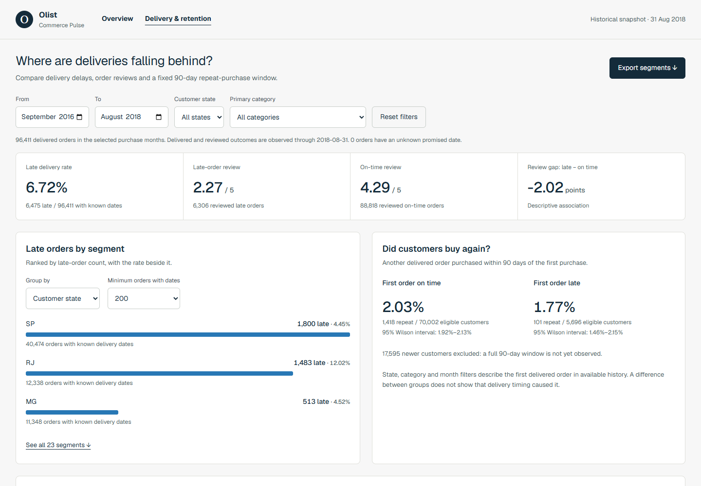
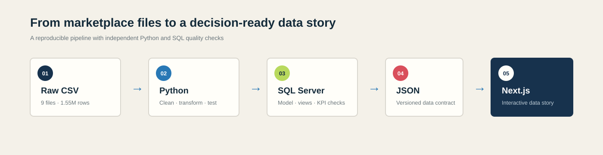
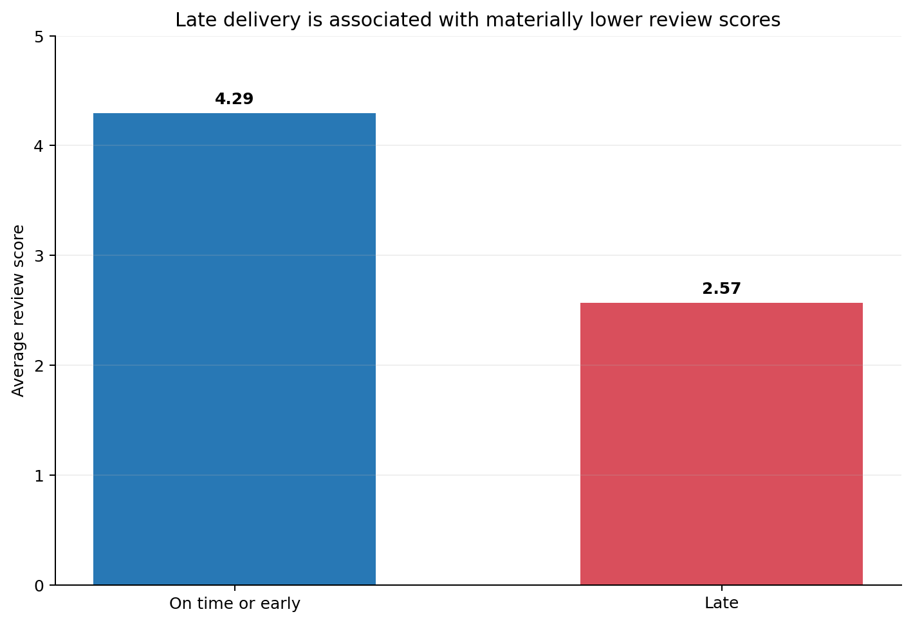
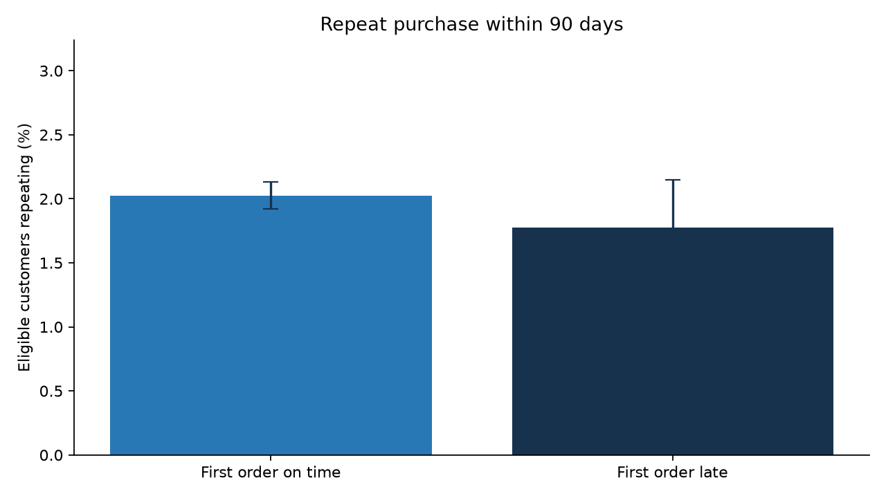

# Olist E-commerce Analytics

[English](README.md) · [Tiếng Việt](README.vi.md)

An analysis of Olist sales, delivery delays and repeat purchases. Python prepares the data; SQL Server holds the relational model; Next.js and Power BI present the results.



Actual Next.js report. The screenshot uses the delivery snapshot through **31 Aug 2018**.

## Delivery and repeat-purchase findings

- **96,411** delivered orders observed by the cutoff; **6,475 / 96,411 (6.72%)** arrived late.
- Mean review: **2.27/5** for late orders (**6,306** reviewed orders), versus **4.29/5** for on-time orders (**88,818**).
- Repeat purchase within 90 days: **1,418 / 70,002 (2.03%)** after an on-time first order; **101 / 5,696 (1.77%)** after a late first order.
- **17,595** newer customers are excluded because a complete 90-day follow-up is unavailable.

The repeat-rate confidence intervals overlap. These comparisons describe associations; they do not establish that delivery timing caused a change in customer behaviour. See the [case study](reports/delivery_case_study.md) and [exact counts](reports/delivery_findings.json).

## What is in the project

- Cleaning and validation for nine related CSV files, with tests for keys, joins and order-level aggregation.
- SQL Server staging/core tables, views, KPI queries and data-quality checks.
- A sales overview and a `/delivery` report with month/state/category filters, review sample sizes and a filtered CSV export.
- A [two-page Power BI project](powerbi/README.md), with TMDL model, Power Query and 19 DAX measures. [Desktop DAX checks](reports/powerbi_validation.json) reconcile totals, cohorts, the RJ filter and small-sample thresholds with Python. The saved report is `.pbip`; a `.pbix` export is not included.
- An [EDA notebook](notebooks/01_olist_eda.ipynb) and charts generated from the processed data.



## Sales overview: a different scope

The overview uses the final delivered-order dataset, rather than only deliveries observed by 31 Aug. It contains **96,478** delivered orders and **R$15.42M** of payment-based GMV, including freight. Comparable Jan–Aug GMV grew **143.3%** from 2017 to 2018.

Its corrected late rate is **6,534 / 96,470 known-date orders (6.77%)**; eight delivered orders have missing delivery dates. Use **6.72%** for the dated delivery snapshot and **6.77%** for the full-data overview.

Late now compares calendar dates. The earlier timestamp calculation incorrectly marked **1,292 same-day deliveries** as late. The old **8.11%** rate and unrestricted late/on-time repeat comparison are superseded. The current cohort uses the same 90-day window for both groups.

## Selected charts





## Run locally

Download the nine source CSVs listed in [data/README.md](data/README.md) into `data/raw/`. Raw data is excluded from Git.

```sh
python -m venv .venv
# Activate .venv for your shell, then:
python -m pip install -r requirements.txt
python src/run_pipeline.py
python -m unittest discover -s tests -v
cd dashboard
npm ci
npm run dev
```

Open `http://localhost:3000` for the overview and `/delivery` for the filtered report. The pipeline also exports the local Power BI CSVs. To use the Power BI project on another machine, run `python powerbi/configure.py` from the repository root, then open the `.pbip` and refresh in Desktop. The web dashboard runs independently of Desktop.

In `dashboard/`, `npm test` checks metric calculations and `npm run validate` runs lint, type-check and production build. CI runs the Python suite, dashboard checks and PBIR validation.

## SQL and analysis notes

Follow [sql/README.md](sql/README.md) for script order, including `07_delivery_retention.sql`. Reload the corrected processed data first. The new delivery/retention query still needs a fresh SQL Server parity run; Desktop DAX validation is recorded separately.

- [Data model](reports/data_model.md)
- [Processing notes](reports/processing_notes.md)
- [SQL validation status](reports/sql_kpi_results.md)
- [Dashboard data contracts](dashboard/README.md)

The data is historical and ends in 2018. It has no carrier-level detail and cannot establish current Olist performance or causal effects. Code: [MIT](LICENSE); source data remains subject to its original terms.
