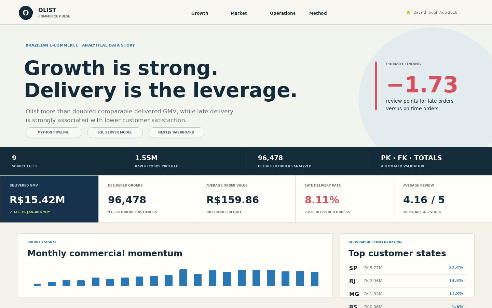
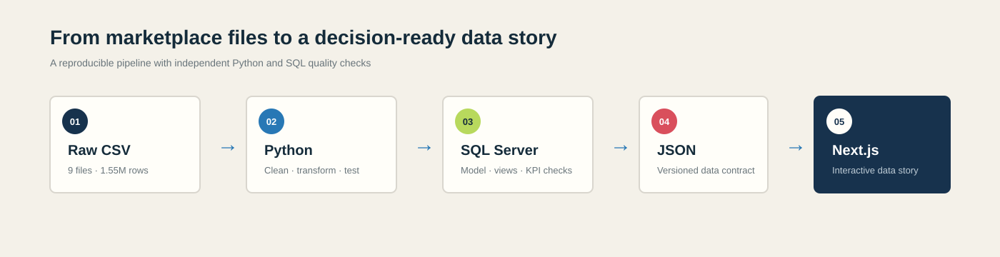
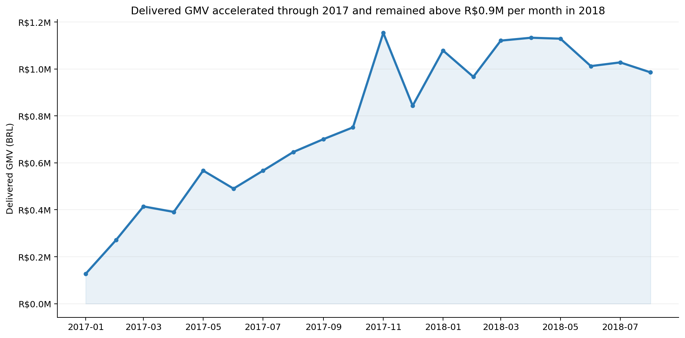
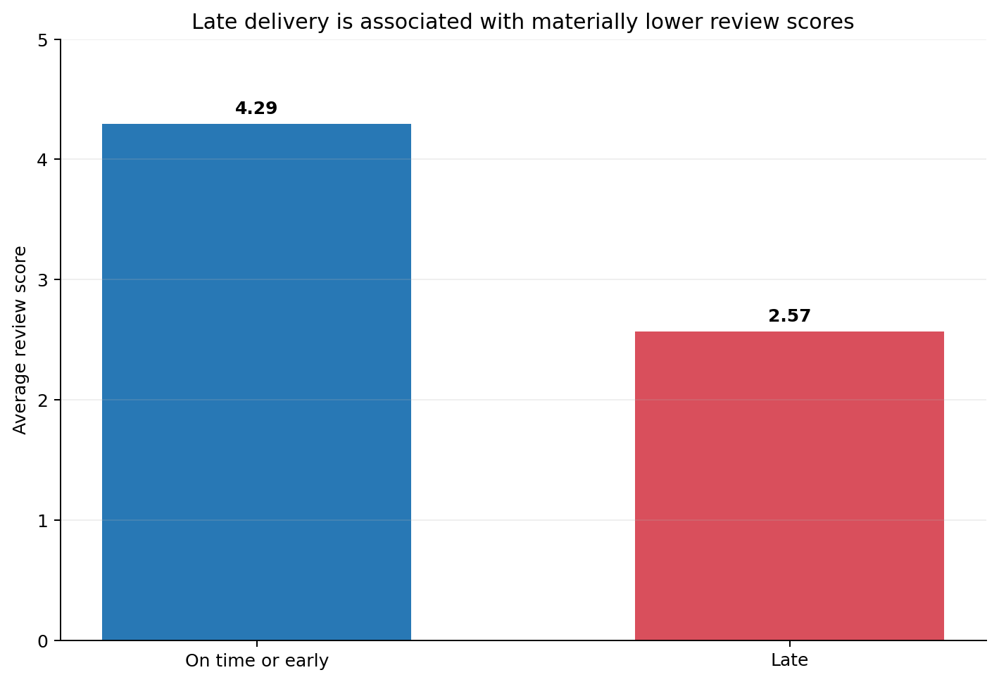
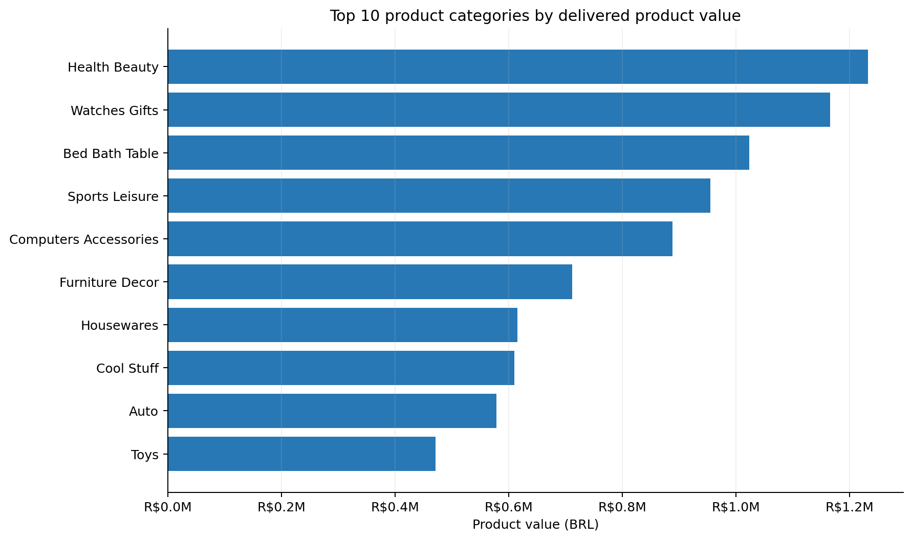
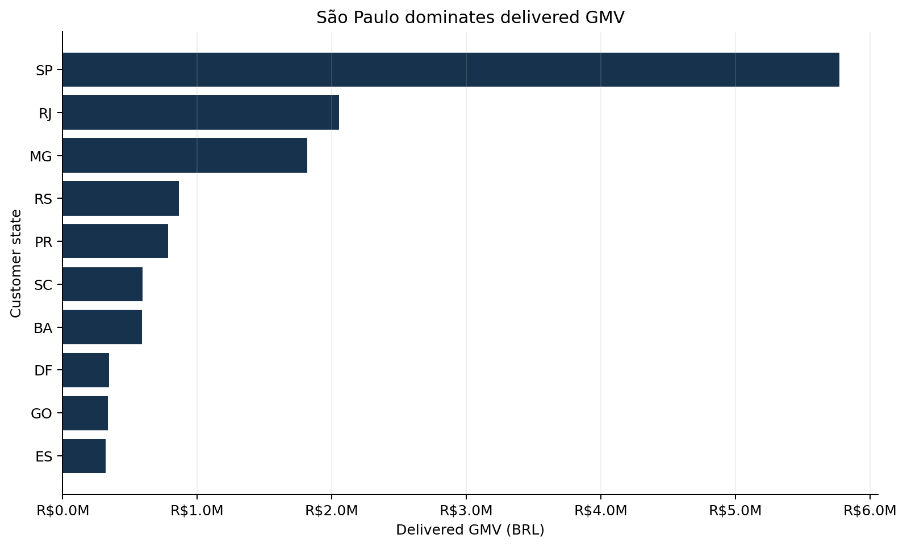
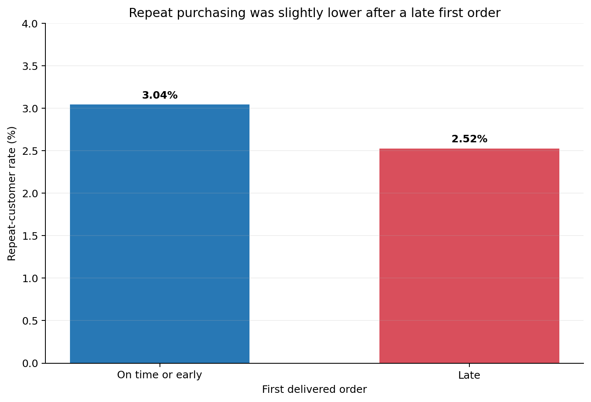

# Olist E-commerce Analytics

[🇬🇧 English](README.md) · [🇻🇳 Tiếng Việt](README.vi.md)

Dự án portfolio Data Analyst đầy đủ end-to-end: chuyển bộ dữ liệu sàn thương mại điện tử Olist (Brazil) thành pipeline Python có thể tái lập, mô hình SQL Server đã kiểm chứng, phân tích kinh doanh có tài liệu đầy đủ, và một data story tương tác bằng Next.js.



## Tổng quan dự án

| Phạm vi | Kết quả |
|---|---:|
| Dữ liệu nguồn | 9 file CSV · 1,550,922 dòng |
| Đơn hàng đã giao được phân tích | 96,478 |
| GMV đơn đã giao | R$15.42M |
| Tăng trưởng GMV Jan–Aug (cùng kỳ) | +143.3% YoY |
| Tỷ lệ giao trễ | 8.11% |
| Chênh lệch điểm đánh giá của đơn trễ | −1.73 điểm |

> **Định nghĩa metric:** Delivered GMV là tổng giá trị thanh toán của khách cho các đơn đã giao, bao gồm phí ship. Product value được báo cáo riêng và không bao gồm phí ship.

## Câu hỏi kinh doanh

1. GMV đơn đã giao và số lượng đơn thay đổi thế nào theo thời gian?
2. Ngành hàng và tỉnh/bang khách hàng nào tạo ra nhiều giá trị nhất?
3. Hiệu suất giao hàng liên quan thế nào đến điểm đánh giá?
4. Mảng vận hành nào đáng để đào sâu thêm?
5. Tỷ lệ khách quay lại thấp nói lên điều gì cho phân tích retention?

## Những gì tôi đã xây dựng

- Pipeline Python tái sử dụng để làm sạch 9 file CSV liên quan.
- Kiểm tra tự động: số dòng, khóa chính, khóa kết hợp, khóa ngoại, định dạng mã ZIP, và các trường tính toán.
- Mô hình staging và core trên SQL Server 2019 với constraint, index, view tái sử dụng, truy vấn KPI, và kiểm tra chất lượng dữ liệu.
- Jupyter Notebook đã chạy để phân tích khám phá và tạo biểu đồ cho portfolio.
- Dashboard Next.js import file `analytics.json` được sinh ra tự động, thay vì hardcode giá trị KPI.
- Script setup và tài liệu để chạy lại được ở local.

## Pipeline dữ liệu



```text
File CSV gốc
    ↓
Làm sạch và kiểm tra bằng Python
    ↓
File CSV phân tích đã xử lý
    ├── SQL Server staging → core model → kiểm tra KPI
    └── Sinh ra dashboard/data/analytics.json
                              ↓
                         Dashboard Next.js
```

## Phát hiện chính

- GMV đơn đã giao đạt **R$15.42M** trên **96,478** đơn đã giao.
- GMV đơn đã giao Jan–Aug 2018 cao hơn **143.3%** so với cùng kỳ 2017.
- **8.11%** đơn đã giao đến trễ hơn ngày giao dự kiến.
- Đơn giao trễ có điểm đánh giá trung bình **2.57/5**, so với **4.29/5** của đơn giao đúng hạn hoặc sớm.
- SP, RJ, và MG tạo ra khoảng **62.5%** GMV đơn đã giao.
- Tỷ lệ khách quay lại mua khoảng **3.0%**.
- Khách có đơn đầu tiên giao trễ quay lại mua ở mức **2.52%**, so với **3.04%** ở khách có đơn đầu giao đúng hạn hoặc sớm. Đây là liên hệ mang tính mô tả, không phải ước lượng nhân quả.

## Phân tích tiêu biểu

<table>
  <tr>
    <td width="50%"></td>
    <td width="50%"></td>
  </tr>
  <tr>
    <td align="center"><strong>Đà tăng trưởng kinh doanh</strong></td>
    <td align="center"><strong>Giao hàng và sự hài lòng khách hàng</strong></td>
  </tr>
</table>

<table>
  <tr>
    <td width="50%"></td>
    <td width="50%"></td>
  </tr>
  <tr>
    <td align="center"><strong>Danh mục sản phẩm</strong></td>
    <td align="center"><strong>Mức độ tập trung theo khu vực</strong></td>
  </tr>
</table>

<table>
  <tr>
    <td width="100%"></td>
  </tr>
  <tr>
    <td align="center"><strong>Retention theo trải nghiệm giao hàng của đơn đầu tiên</strong></td>
  </tr>
</table>

## Cấu trúc repository

```text
assets/          Ảnh preview dashboard, sơ đồ, và biểu đồ phân tích
data/
  raw/           File nguồn gốc, không đưa lên Git
  processed/     File phân tích đã sinh ra, không đưa lên Git
  sample/        Tài liệu cho ví dụ dữ liệu mẫu nhẹ
notebooks/       Notebook phân tích khám phá đã chạy
reports/         Tài liệu data model, inventory, processing, và KPI
sql/             Schema, transform, view, KPI, và kiểm tra trên SQL Server
src/             Script Python xử lý, kiểm tra, và export dữ liệu cho dashboard
dashboard/       Next.js, React, TypeScript, và file analytics JSON đã sinh ra
```

## Chạy ở local

### 1. Lấy bộ dữ liệu

Tải bộ **Brazilian E-Commerce Public Dataset by Olist** từ Kaggle và đặt 9 file CSV gốc vào `data/raw/`. Tên file chính xác được liệt kê trong [`data/README.md`](data/README.md).

Gói local tải về của project này đã sẵn có dữ liệu nguồn. Các file này vẫn bị loại trừ bởi `.gitignore`, nên sẽ không bị push lên GitHub khi dùng Git bình thường.

### 2. Build và kiểm tra dữ liệu phân tích

```bash
python -m venv .venv

# Windows (PowerShell)
.venv\Scripts\Activate.ps1

# macOS/Linux
source .venv/bin/activate

python -m pip install -r requirements.txt
python src/run_pipeline.py
```

Chạy thành công sẽ kết thúc bằng:

```text
CHECKS_OK|files=9|orders=99441|items=112650
DASHBOARD_DATA_OK|dashboard/data/analytics.json
PIPELINE_OK
```

### 3. Chạy dashboard

```bash
cd dashboard
npm install
npm run dev
```

Mở `http://localhost:3000`.

### 4. Build bản production của dashboard

```bash
cd dashboard
npm run lint
npm run build
```

### 5. Continuous integration

`.github/workflows/quality.yml` chạy các kiểm tra tương tự ở mỗi lần push: compile source Python, validate `dashboard/data/analytics.json`, sau đó lint, type-check, và build dashboard.

## Quy trình SQL Server

Xem [`sql/README.md`](sql/README.md), sau đó chạy các script theo thứ tự sau:

1. `00_create_database.sql`
2. `01_create_tables.sql`
3. `02_bulk_load_staging.sql`
4. `03_transform_to_core.sql`
5. `04_create_views.sql`
6. `06_data_quality_checks.sql`
7. `05_kpi_analysis.sql`

## Tài liệu

- [Mô hình dữ liệu](reports/data_model.md)
- [Kiểm kê dữ liệu gốc](reports/raw_data_inventory.md)
- [Ghi chú xử lý](reports/processing_notes.md)
- [Kết quả KPI từ SQL](reports/sql_kpi_results.md)
- [Notebook EDA đã chạy](notebooks/01_olist_eda.ipynb)
- [Tài liệu dashboard](dashboard/README.md)

## Hạn chế

- Phân tích mang tính quan sát (observational), không khẳng định giao trễ là nguyên nhân gây ra điểm đánh giá thấp hơn hay tỷ lệ quay lại thấp hơn.
- Dữ liệu kết thúc năm 2018, không phản ánh hiệu suất hiện tại của Olist.
- Danh tính khách hàng đã được ẩn danh hóa, không có thuộc tính nhân khẩu học.
- Không có dữ liệu ở cấp đơn vị vận chuyển, nên các đề xuất về logistics cần thêm dữ liệu vận hành.
- Dữ liệu gốc không được đưa lên GitHub vì lý do dung lượng repo, cần tải riêng.

## Công nghệ sử dụng

`Python` · `Pandas` · `Jupyter` · `SQL Server 2019` · `T-SQL` · `Next.js` · `React` · `TypeScript` · `CSS`

## Giấy phép

Mã nguồn của project được phát hành theo [Giấy phép MIT](LICENSE). Bộ dữ liệu Olist vẫn tuân theo điều khoản gốc của nguồn dữ liệu.
