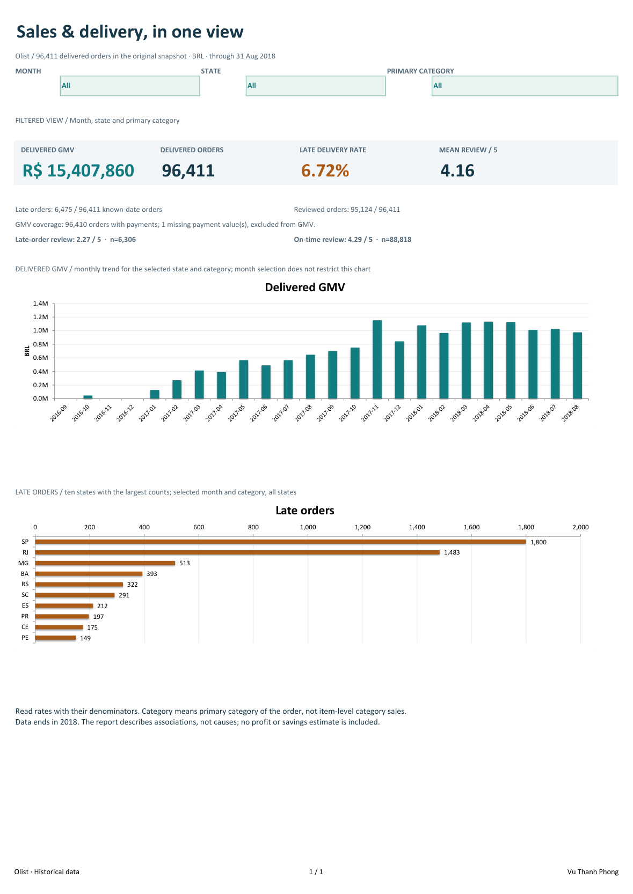
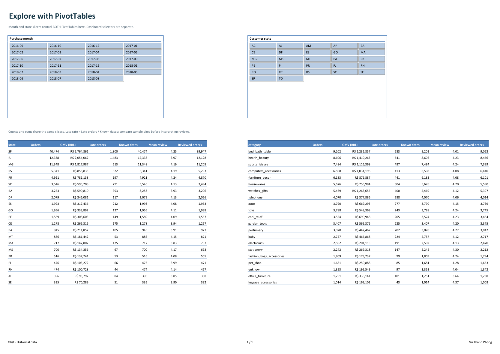

# Excel sales and delivery report

[Tiếng Việt](README.vi.md) · [Download the workbook](https://github.com/Frey-Rayford/Olist-Ecommerce-Analytics/raw/refs/heads/main/excel/Olist_Operations.xlsx)

An Excel version of the Olist delivery snapshot, for a reviewer who wants to filter the report, inspect the formulas and explore the underlying orders without running Python or SQL Server. The workbook includes all **96,411 delivered orders observed by 31 Aug 2018**. It has no macros, API calls or external workbook links.



## Open and explore

Use desktop Excel for Windows for the full Power Query and slicer workflow. The delivered file was built and checked in Excel 16.0 on Windows. Other spreadsheet applications have not been verified. A downloaded file may open in Protected View; enable editing only if you trust its source. No refresh is needed to view the saved results.

- **Dashboard:** choose month, customer state and primary category in the green cells. KPIs follow all three selectors. The monthly chart ignores the month selector to preserve the trend; the state chart ignores the state selector to show the comparison. Both scopes are labelled on the sheet.
- **Monthly / States:** inspect `SUMIFS`, `COUNTIFS`, `IF`, `IFERROR`, `INDEX/MATCH` and ranking formulas. Zero-order calendar months remain visible. Undefined rates and growth are shown as an em dash rather than zero.
- **Explore:** two native PivotTables, grouped by state and primary category, share month and state slicers. These slicers are independent of Dashboard selectors. Clear the slicer filters to return to the full snapshot.
- **Checks:** compare totals with Python baselines and look for missing values or stale query output. Clear Explore slicers before checking pivot totals.
- **Source_Orders / Orders:** the input Excel Table and Power Query output. `Lists` contains dropdown values and the state-to-region lookup.



## What the numbers mean

The grain is one order, after aggregating payments and reviews in Python. This prevents item/payment joins from multiplying the same order. GMV is the sum of payments, including freight; it is not profit. Each order is assigned to the category with the largest product value, with alphabetical tie-breaking. **Category-filtered GMV allocates the entire order to its primary category**, not just items in that category.

Power Query normalizes state/category text, casts dates and numbers, checks IDs and invalid values, and derives the purchase month, delivery status and aggregation flags. Same-day delivery is on time. Missing promised dates are excluded from the late-rate denominator; missing reviews are excluded from review averages. Review averages weight each reviewed order equally, not each state equally.

For the original snapshot, late delivery is **6,475 / 96,411 (6.72%)**. Late orders average **2.27/5** across **6,306** reviewed orders; on-time orders average **4.29/5** across **88,818**. This is observational historical data, not proof that delivery timing causes lower ratings. The workbook does not add a separate repeat-purchase analysis.

## Refresh the embedded source

The original snapshot has **one order without payment data**. It remains in order counts but is excluded from GMV. The dashboard shows payment coverage and Checks flags it for review; no payment value is invented.

If a non-empty selection has no payment values at all, GMV is unavailable, not zero. Monthly growth is shown only when both months have at least 200 orders and the prior GMV is positive; this is a reporting guard against tiny baselines, not a statistical significance test.

1. In `Source_Orders`, replace rows **inside `tblSource`**, keeping its eight column headers and one row per order. Resize the table when the new row count differs; do not leave old rows below new ones.
2. Open **Data > Queries & Connections**, right-click **OrdersQuery > Refresh**, and wait for completion. The query reads `tblSource` inside this file, so there is no machine-specific data path.
3. On `Explore`, right-click a PivotTable and choose **Refresh**. Both pivots use the same cache. Formula sheets recalculate automatically when Excel calculation is set to Automatic.
4. Review `Checks`. The Python baselines describe the original snapshot and will intentionally differ after changing the source.

Refresh is explicit and ordered; the workbook does not use a macro to refresh queries and pivots in sequence. Power Query rejects duplicate IDs, invalid review scores, negative GMV and dates outside the snapshot. If refresh fails, Excel may retain the last successful output: fix the source and refresh again before interpreting the dashboard. The Checks sheet catches row-count and GMV differences, but cannot detect every stale field edit.

This workbook is scoped to the historical cutoff, with fixed month/category lists from that snapshot. To use another period or new categories, update the query cutoff, dropdown lists and baseline definitions rather than presenting the result as the original snapshot.

## Rebuild from the project data

Requires Windows, installed desktop Excel and Python. From the repository root, with processed Olist data already available:

```powershell
python -m pip install -r excel/requirements.txt
python excel/build_workbook.py
python excel/validate_package.py
```

The builder reuses `src.delivery_analysis.build_facts`, creates the workbook layout and input table, then opens its **own Excel instance** to load [orders.pq](orders.pq), create native PivotTables/slicers, calculate and validate the result. Close the output workbook before rebuilding. The builder replaces `excel/Olist_Operations.xlsx` and does not modify the web or Power BI data.

[validation.json](validation.json) records the desktop checks: Python parity for several filter combinations, the shared RJ slicer, a source-value edit followed by refresh and restoration, formula errors and reopening the saved file. Package validation checks the saved workbook in CI; it does not execute Power Query on Linux.

## Data attribution

Source: [Brazilian E-Commerce Public Dataset by Olist](https://www.kaggle.com/datasets/olistbr/brazilian-ecommerce), published by Olist and collaborators. The included data and derived data workbook are shared under [CC BY-NC-SA 4.0](https://creativecommons.org/licenses/by-nc-sa/4.0/). This project filters delivered orders to the cutoff, aggregates payments and reviews, assigns primary categories and derives reporting fields. Build scripts remain under the repository's MIT license.
