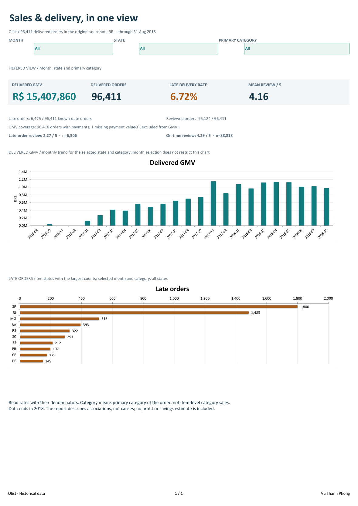
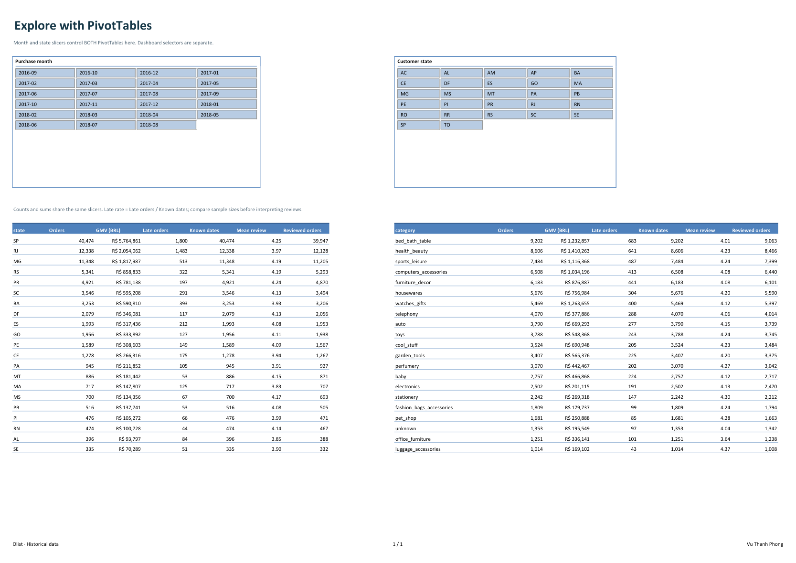

# Báo cáo bán hàng và giao hàng bằng Excel

[English](README.md) · [Tải workbook](https://github.com/Frey-Rayford/Olist-Ecommerce-Analytics/raw/refs/heads/main/excel/Olist_Operations.xlsx)

Bản Excel dành cho người muốn lọc báo cáo, kiểm tra công thức và xem từng đơn mà không cần chạy Python hay SQL Server. File có sẵn **96.411 đơn đã giao được quan sát đến 31/08/2018**, không dùng macro, API hay liên kết tới workbook ngoài.



## Mở file và sử dụng

Nên dùng Excel Desktop trên Windows để sử dụng đầy đủ Power Query và slicer. File đã được dựng và kiểm tra bằng Excel 16.0 trên Windows; chưa xác minh trên ứng dụng bảng tính khác. File tải xuống có thể mở ở Protected View; chỉ bật chỉnh sửa nếu bạn tin cậy nguồn. Không cần refresh để xem kết quả đã lưu.

- **Dashboard:** chọn tháng, bang khách hàng và nhóm hàng chính trong các ô xanh. KPI theo cả ba lựa chọn. Biểu đồ tháng giữ toàn bộ trục thời gian; biểu đồ bang giữ tất cả bang để so sánh. Phạm vi được ghi ngay trên từng biểu đồ.
- **Monthly / States:** xem công thức `SUMIFS`, `COUNTIFS`, `IF`, `IFERROR`, `INDEX/MATCH` và xếp hạng. Tháng không có đơn vẫn xuất hiện. Tỷ lệ hoặc tăng trưởng không xác định hiển thị dấu gạch, không giả thành 0.
- **Explore:** hai PivotTable thật theo bang và nhóm hàng chính, dùng chung slicer tháng/bang. Slicer này tách biệt với bộ chọn trên Dashboard. Bấm biểu tượng xóa bộ lọc của slicer để xem lại toàn bộ dữ liệu.
- **Checks:** đối chiếu số liệu với Python, kiểm tra dữ liệu thiếu và một số dấu hiệu chưa refresh. Xóa bộ lọc ở Explore trước khi so tổng PivotTable.
- **Source_Orders / Orders:** bảng đầu vào và đầu ra Power Query. `Lists` chứa danh sách lựa chọn và bảng tra bang–vùng.



## Hiểu đúng chỉ số

Mỗi dòng là **một đơn hàng**, sau khi Python gộp các dòng thanh toán và review. Cách này tránh nhân số liệu do một đơn có nhiều sản phẩm hoặc nhiều lần thanh toán. GMV là tổng tiền thanh toán, gồm vận chuyển; không phải lợi nhuận. Nhóm hàng chính được chọn theo tổng giá trị sản phẩm lớn nhất trong đơn, hòa thì xếp theo tên. **GMV theo nhóm hàng chính phân bổ toàn bộ tiền của đơn vào nhóm đó**, không phải doanh thu riêng từng sản phẩm trong nhóm.

Power Query chuẩn hóa bang/nhóm hàng, chuyển kiểu ngày và số, kiểm tra ID và giá trị không hợp lệ, rồi tạo tháng mua, trạng thái giao hàng và các cột phục vụ phép tính. Giao trong đúng ngày hẹn được tính là đúng hạn. Thiếu ngày hẹn thì loại khỏi mẫu số tỷ lệ trễ; thiếu review thì loại khỏi trung bình review. Mỗi đơn có review có trọng số bằng nhau, không lấy trung bình các trung bình theo bang.

Snapshot gốc có **6.475 / 96.411 đơn (6,72%)** giao trễ. Review của nhóm trễ là **2,27/5** trên **6.306** đơn, nhóm đúng hẹn là **4,29/5** trên **88.818** đơn. Đây là liên hệ mô tả trên dữ liệu lịch sử, chưa chứng minh quan hệ nhân quả. Workbook không bổ sung phân tích mua lại riêng.

## Cập nhật dữ liệu trong workbook

Snapshot gốc có **một đơn thiếu dữ liệu thanh toán**. Đơn đó vẫn nằm trong số đơn nhưng không cộng vào GMV. Dashboard hiển thị số đơn có thanh toán và Checks đánh dấu cần xem; không tự điền số tiền bị thiếu.

Nếu có đơn nhưng toàn bộ đều thiếu thanh toán thì GMV không xác định, không hiển thị thành 0. Tăng trưởng tháng chỉ hiện khi cả hai tháng có ít nhất 200 đơn và GMV tháng trước dương; đây là quy tắc tránh so với mốc quá nhỏ, không phải kiểm định thống kê.

1. Thay dữ liệu **bên trong bảng `tblSource`** ở `Source_Orders`, giữ nguyên tám tiêu đề và mỗi dòng một đơn. Đổi kích thước bảng nếu số dòng thay đổi; tránh để sót dòng cũ phía dưới.
2. Vào **Data > Queries & Connections**, bấm phải **OrdersQuery > Refresh**, đợi chạy xong. Query đọc bảng trong chính file này, không cần sửa đường dẫn ổ đĩa.
3. Sang `Explore`, bấm phải PivotTable > **Refresh**. Hai PivotTable dùng chung cache. Các sheet công thức tự tính khi Excel đặt chế độ Automatic.
4. Xem `Checks`. Mốc đối chiếu Python là dữ liệu gốc; nếu cố ý đổi nguồn thì phần chênh lệch với mốc gốc có thể khác 0.

Refresh theo thứ tự trên; file không dùng macro để tự điều phối. Query từ chối ID trùng, review ngoài thang điểm, GMV âm hoặc ngày ngoài snapshot. Nếu refresh lỗi, Excel có thể còn giữ kết quả cũ: sửa nguồn và refresh lại trước khi đọc báo cáo. Checks bắt được chênh lệch số dòng và GMV nhưng không phát hiện được mọi trường hợp sửa một ô mà chưa refresh.

Workbook giới hạn theo ngày chốt lịch sử; danh sách tháng/nhóm hàng lấy từ snapshot này. Muốn dùng kỳ khác hoặc nhóm hàng mới cần sửa ngày chốt query, danh sách chọn và mốc đối chiếu.

## Dựng lại từ dữ liệu dự án

Cần Windows, Excel Desktop đã cài và Python. Từ thư mục gốc repo, khi đã có dữ liệu processed:

```powershell
python -m pip install -r excel/requirements.txt
python excel/build_workbook.py
python excel/validate_package.py
```

Script dùng lại `src.delivery_analysis.build_facts`, tạo bố cục và dữ liệu đầu vào rồi mở **một phiên Excel riêng** để chạy [orders.pq](orders.pq), tạo PivotTable/slicer, tính và kiểm tra. Đóng workbook trước khi dựng lại. Script ghi đè `excel/Olist_Operations.xlsx`, không thay dữ liệu web hay Power BI.

[validation.json](validation.json) lưu kết quả kiểm tra trên Desktop: đối chiếu Python với nhiều bộ lọc, slicer RJ tác động lên cả hai PivotTable, sửa một giá trị nguồn rồi refresh và khôi phục, kiểm tra ô lỗi và mở lại file đã lưu. CI kiểm tra cấu trúc và kết quả lưu trong file; không chạy Power Query trên Linux.

## Nguồn dữ liệu

[Brazilian E-Commerce Public Dataset by Olist](https://www.kaggle.com/datasets/olistbr/brazilian-ecommerce), do Olist và cộng tác viên công bố. Dữ liệu kèm file và workbook dẫn xuất theo [CC BY-NC-SA 4.0](https://creativecommons.org/licenses/by-nc-sa/4.0/). Dự án lọc đơn đã giao theo ngày chốt, gộp thanh toán/review, chọn nhóm hàng chính và thêm cột báo cáo. Mã dựng file theo MIT của repo.
