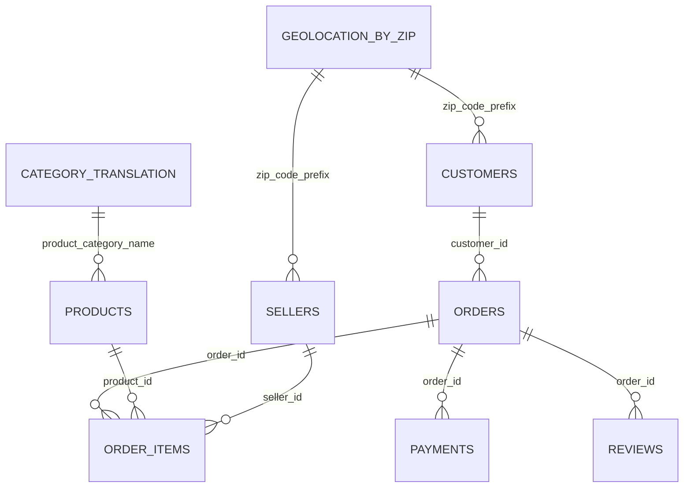

# Olist data model

Last validated: 2026-08-06

## Relationship overview

`GEOLOCATION_BY_ZIP` is generated during processing. The original geolocation table cannot be joined directly at ZIP-code grain because one ZIP prefix can contain many coordinate rows.

## Keys used

| Table | Key | Validation result |
|---|---|---|
| Customers | `customer_id` | Unique and non-null |
| Orders | `order_id` | Unique and non-null |
| Products | `product_id` | Unique and non-null |
| Sellers | `seller_id` | Unique and non-null |
| Category translation | `product_category_name` | Unique and non-null |
| Order items | `order_id` + `order_item_id` | Unique composite key |
| Payments | `order_id` + `payment_sequential` | Unique composite key |
| Reviews | `review_id` + `order_id` | Unique composite key |

## Modeling decisions

- `review_id` alone is not sufficient: 1,603 rows belong to duplicated `review_id` groups.
- Geolocation is aggregated to one row per ZIP prefix using mean coordinates and the most frequent city and state.
- All required order, product, seller, payment, and review relationships pass orphan checks.
- Thirteen products belong to two categories missing from the translation file. Their original Portuguese category is preserved as a fallback.
- Some customer and seller ZIP prefixes are absent from the geolocation file. Transaction rows are retained and geographic attributes remain nullable.
- Payments, items, and reviews are aggregated to order grain before joining to avoid row multiplication.
